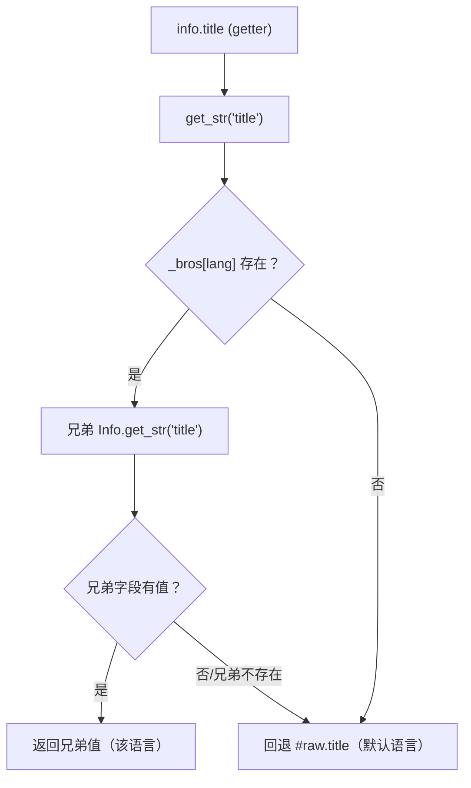

# Info 的多语言（i18n）原理

`Info` 是 `src/base/Info.tsx` 中 mod 信息的核心运行时模型，其 i18n 由
`src/base/MakeUstr.ts` 的装饰器（`@Cls` / `@Str`）与 `Info.get_str` / `set_str` 协作实现。

核心思想一句话：**数据默认语言存顶层，其他语言存 `raw.i18n[lang]`，getter 在「读取时」按当前语言回退**。

---

## 1. 数据模型

`Info` 内部持有纯数据 `#raw`（IInfo），多语言按如下布局存放：

```jsonc
{
  "title": "Little Fighter 2",            // 默认语言（''）字段直接放顶层
  "desc": "English description",
  "desc_url": "user/1/2/xxxx",
  "i18n": {                               // 其他语言
    "zh": {
      "title": "热血格斗",
      "desc": "中文描述",
      "desc_url": "user/1/2/yyyy"
    },
    "ja": "zh"                            // 别名：值指向另一个语言键
  }
}
```

- 顶层 = 默认语言（`''`，一般为英文）。
- `raw.i18n` 的每个键 = 一种语言；值可以是**对象**（该语言的字段）或**字符串**（别名，指向另一个语言键）。
- 语言字符串本身存在 `Info.lang` 字段上。

---

## 2. 装饰器机制（MakeUstr.ts）

```ts
export function makeI18N() {
  const fields = new Set<string>();                 // ← 模块级单例集合

  function Str(_, desc) {                           // ① 字段装饰器：编译期收集字段名
    const { name } = desc;
    if (desc.kind !== 'field' || desc.static || typeof name !== 'string') return
    fields.add(name)
  }

  function Cls(cls) {                               // ② 类装饰器：运行期注入 getter/setter
    return class extends cls {
      constructor(...args) {
        super(...args);
        for (const field of fields) {
          this[`set_${field}`] = function (v) { this[field] = v; return this; }
          Object.defineProperty(this, field, {
            get: () => this.get_str(field),         // 读取 → i18n 回退
            set: (v) => this.set_str(field, v),     // 写入 → 写 #raw（默认层）
          })
        }
      }
    }
  }
  return { Cls, Str }
}
```

流程分两步：

1. **编译期收集**：`@Str title !: ...` 在类定义时把被装饰的字段名（`title`、`author`、`brief`……）加入 `fields`。
2. **运行期注入**：`@Cls` 返回匿名子类，构造时对每个收集到的字段：
   - 生成链式 setter（`set_title(v)`）；
   - 用 `Object.defineProperty` 把字段重定义为 getter/setter，分别委托给 `get_str` / `set_str`。

因此 `info.title` 表面上是普通属性访问，实际走的是 `get_str('title')`。

---

## 3. 读取回退（get_str）

```ts
get_str<K extends keyof IInfo>(key: K) {
  const value =
    this._bros[this.lang]?.get_str(key) ||   // ① 优先：当前语言兄弟
    this.#raw[key];                          // ② 回退：默认语言（顶层）
  if (value === void 0 || value === null) return void 0
  if (Array.isArray(value)) return value.join('\n')
  return '' + value;
}
```

读取 `info.title` 的判定顺序：

1. 找 `_bros[this.lang]`（当前语言的兄弟 `Info`，`load` 时从 `raw.i18n` 构建）；
2. 兄弟存在则递归调用它的 `get_str`（兄弟内部再回退它自己的顶层，即该语言的字段）；
3. 兄弟不存在或字段为空 → 回退 `this.#raw[key]`（默认语言）。



---

## 4. 写入路径（set_str）

```ts
set_str(key, v) {
  return this.#raw[key] = v;
}
```

- `info.set_title('...')` 或 `info.title = '...'` 最终都写 **`#raw` 顶层（默认语言）**。
- **不会**写到当前 `lang` 的 `i18n` 层——写入永远针对默认语言，这是刻意的取舍（新增内容以默认语言落盘，其余语言是覆盖层）。
- `_bros` / `_subs` 树只在 `load()` 时重建，**直接改 `#raw` 后不会自动同步**，所以修改数据必须走 setter 或整体 `load()`。

---

## 5. load() 如何构建语言树

```ts
load(raw: IInfo) {
  this.#raw = JSON.parse(JSON.stringify(raw));       // 深拷贝 + 去掉 undefined 键
  const bros = this.#raw.i18n;
  const bro_keys = this.#raw.i18n && Object.keys(this.#raw.i18n);
  if (bros && bro_keys?.length) {
    for (const bro_key of bro_keys) {
      let bro = bros[bro_key];
      if (typeof bro === 'string') {                 // 别名：解析成真实语言对象
        if (alias_paths.has(bro)) throw new Error('i18n bad loop!');
        bro = bros[bro];
        alias_paths.add(bro);
      }
      if (!bro || !Object.keys(bro).length) {        // 空对象直接丢弃
        delete bros[bro_key];
        continue;
      }
      this._bros[bro_key] = new Info(bro, bro_key, this.parent, this.src);
    }
  } else {
    delete this.#raw.i18n;                           // 无 i18n 时清掉空字段
  }
  // 特殊：i18n[''] 作为「默认语言的补充」，合并进顶层后删除
  if (this._bros['']) {
    Object.assign(this.#raw, this._bros[''].raw);
    delete this.#raw.i18n?.[''];
    delete this._bros[''];
  }
}
```

要点：

- 每个语言键生成一个独立的兄弟 `Info`（其 `lang` = 该键），兄弟之间共享 `parent` / `src`，但 `#raw` 各自深拷贝。
- **别名**（值为字符串）会解析为指向语言的副本；`alias_paths` 用于检测别名循环（`a -> b -> a` 抛错）。
- **空对象**（无字段的语言）会被删除。
- **`i18n['']`** 是「默认语言补充层」，`load` 时并入顶层 `#raw` 后移除——这样默认语言数据统一在顶层，读取回退逻辑更简单。

---

## 6. 语言切换：with_lang / clone

```ts
with_lang(lang: string): Info {
  return new Info(this.#raw, lang, this.parent, this.src);  // 同一份 raw，换 lang
}
clone(): Info {
  const ret = new Info(this.#raw, this.lang, this.parent, this.src);
  ret.subs = this.subs?.map(v => v.clone());
  return ret;
}
```

- `with_lang(lang)`：同数据换一个 `lang`，再用同一套 getter 读取，即自动走目标语言的回退。
- `clone()`：深拷贝出一棵独立 `Info` 树（含 `subs`），编辑副本不影响原实例。

---

## 7. 各语言 desc 的收集与加载

```ts
get all_desc(): Map<string, string> {     // 收集所有语言的 desc（'' 与 i18n 各键）
  const ret = new Map<string, string>();
  if (this.#raw.desc?.trim()) ret.set('', this.#raw.desc.trim());
  const subs = this.#raw.i18n;
  if (subs) for (const key in subs) {
    const desc = subs[key].desc?.trim();
    if (desc) ret.set(key, desc);
  }
  return ret;
}

async load_desc(opts) {                   // 按 desc_url 异步拉取各语言 desc 落回 #raw
  // 默认语言：this.#raw.desc = await storageHttp.text(this.full_url(desc_url), opts)
  // 各 i18n 键：this.#raw.i18n[key].desc = await storageHttp.text(...)
}
```

- `all_desc`：保存时把所有语言的描述统一导出（键 `''` = 默认语言，其余为语言键）。
- `load_desc`：描述以 `desc_url` 存 OSS，读取时按需拉取并写回 `#raw`（网络 IO 走 `src/network/storageHttp.ts`）。

---

## 8. 注意事项 / 陷阱

1. **`fields` 是模块级单例**：`const { Cls, Str } = makeI18N()` 只调用一次，所有使用 `@Cls` / `@Str` 的类共享同一字段集合。目前只有 `Info` 使用；将来若第二个类复用，字段会互相污染（A 类的字段会在 B 类构造时被 defineProperty）。
2. **getter 带 i18n 回退，不能直接做表单绑定**：`info.title` 会返回当前语言的值，不适合双向编辑。表单应编辑 `info.raw`（只读深拷贝快照）再 `clone().load(raw)` 写回。
3. **setter 总是写默认层**：`set_title()` 不会写进 `i18n[lang]`。
4. **`_bros` / `_subs` 是 load 时的快照**：之后直接改 `#raw.i18n` 不会自动重建兄弟树，必须走 `load()` 或 setter。
5. **每次 `new Info()` 都会为每个字段 `Object.defineProperty`**：字段多 / 实例多时有少量开销。
6. **装饰器依赖工具链**：本项目通过 `@vitejs/plugin-react` + `@babel/plugin-proposal-decorators`（2023-05 标准装饰器）编译；若工具链未启用装饰器，字段将保持 `undefined`（`set_title !:` 的 `!` 即表示实现由装饰器填充）。

---

## 9. 相关文件

| 文件 | 职责 |
|---|---|
| `src/base/MakeUstr.ts` | `@Cls` / `@Str` 装饰器、`get_str` / `set_str` 类型 |
| `src/base/Info.tsx` | `Info` 模型：`#raw`、`_bros`、`load`、`with_lang`、`all_desc`、`load_desc` |
| `src/network/storageHttp.ts` | desc 等 OSS 对象读取（`text` / `json`） |
